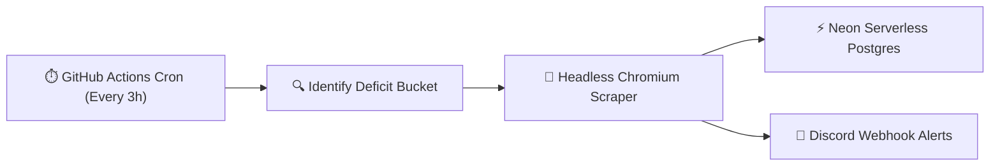

# Stay Trails | Google Maps Scraper Cron 🏔️

Automated Google Maps acquisition scraper cron runner for **Stay Trails** (Indoira Ventures Pvt. Ltd.).

Runs on **free GitHub Actions scheduled runners**, discovers verified stays across North Bengal & Sikkim, deduplicates them against **Neon Serverless Postgres**, and dispatches instant **Discord alerts**.

---

## 🎯 How It Works



1. **Deficit Targeting**: The cron queries Neon Postgres to inspect the target 425 property catalogue quotas across all 5 regions (Darjeeling, Kalimpong, Sikkim, Dooars, Rest of Bengal) and 5 categories. It automatically selects the query with the highest deficit.
2. **Stealth Extraction**: Extracts property name, rating, reviews count, Google Maps URL, address, and phone numbers.
3. **Deduplication**: Checks by normalized 10-digit Indian phone number, Google Maps URL, and fuzzy name matching.
4. **Neon Sync**: Inserts new leads directly into Neon Postgres table `leads` with status `discovered`.
5. **Real-time Discord Alerts**: Dispatches rich embed alerts for every added property and batch execution summary.

---

## ⚙️ GitHub Secrets Configuration

The following repository secrets are configured in GitHub Actions:

* `DATABASE_URL`: Neon Serverless Postgres connection string.
* `DISCORD_WEBHOOK_URL`: Discord channel webhook URL for instant alerts.

---

## 🚀 Manual Execution (Workflow Dispatch)

You can trigger a scrape anytime directly from GitHub:
1. Go to the **Actions** tab in this repo.
2. Select **"Stay Trails Scraper Cron"**.
3. Click **"Run workflow"**.
4. *(Optional)* Select a specific Region, Category, and limit (e.g., `Darjeeling`, `Homestay`, `10`), or leave blank to automatically target the biggest deficit.

---

## 💻 Local Development

```bash
# 1. Install dependencies
bun install

# 2. Configure environment
cp .env.example .env
# Edit .env with your DATABASE_URL and DISCORD_WEBHOOK_URL

# 3. Run scraper
bun run scrape

# 4. Or target a specific region
bun run src/cli.ts --region Darjeeling --category Homestay --limit 6
```
